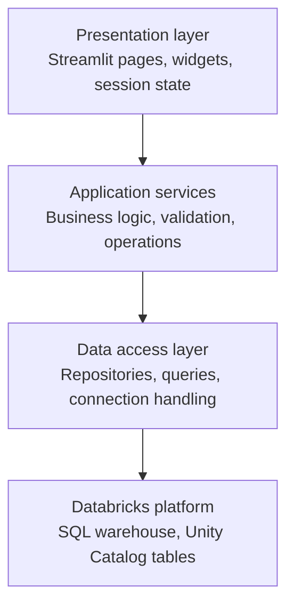

# Building Production-Ready Streamlit Apps on Databricks — Part 1: Architecture, Error Handling, and Observability

*How to structure a maintainable Streamlit application, recover from partial failures, and build useful operational logging without introducing unnecessary complexity.*

A Streamlit application can start with 30 lines of Python. Connect to a Databricks SQL warehouse, execute a query, display a DataFrame, and add a few filters. Within an afternoon, you can have something useful enough to demonstrate to business users.

The architecture becomes more interesting when that demonstration turns into an application people depend on.

Imagine a user-management application running on Databricks Apps. It displays employees, their assigned roles, the countries and regions they can access, and a history of administrative changes. Multiple people use it simultaneously. Some users can view information, while others can modify assignments.

Now imagine that the query retrieving audit history times out. Should the entire page fail? What information should the user see? How does a developer identify which operation failed without exposing internal details or sensitive data?

These questions are less about Streamlit itself and more about how we structure Python applications.

In this first article, we'll build the architectural foundation: separation of responsibilities, reusable error handling, structured JSON logs, and graceful recovery when individual components fail.

## 1. Start with an architecture that can grow

Streamlit encourages a straightforward programming model. Python scripts define the interface, and Streamlit reruns application code when users interact with widgets.

For a prototype, keeping everything in one file is reasonable.

```python
import streamlit as st

st.title("User Management")

users = load_users()
st.dataframe(users)

if st.button("Refresh"):
    users = load_users()
```

But as the application grows, that same file may accumulate SQL queries, permission checks, logging statements, error messages, and business rules.

The problem isn't necessarily the number of lines. It's that changing one responsibility can affect several others.

A more maintainable design separates the application into four areas.



*Reference architecture for a multi-page Streamlit application on Databricks. Error handling, logging, and operation context are shared concerns across the layers.*

The presentation layer should render data and collect user interactions. Application services coordinate operations and apply business rules. Repositories handle data access. Databricks provides the execution environment and governed data resources.

This separation makes it possible to test business logic without starting a Streamlit server and to change database access without rewriting page components.

A practical project structure could look like this:

```text
streamlit-app/
├── app.py
├── pages/
│   ├── users.py
│   └── audit_history.py
├── services/
│   ├── user_service.py
│   └── audit_service.py
├── repositories/
│   ├── user_repository.py
│   └── audit_repository.py
├── core/
│   ├── errors.py
│   ├── decorators.py
│   ├── logging_config.py
│   └── context.py
├── tests/
├── requirements.txt
└── app.yaml
```

The `core` directory contains functionality shared across pages. This is where error handling and logging belong, rather than being reimplemented in every Streamlit component.

## 2. Not every error should stop the page

Consider a page with three independent sections: a user directory, role assignments, and recent administrative changes.

The directory query succeeds. Role assignments load successfully. But the audit-history query fails because the SQL warehouse temporarily cannot complete the request.

An unhandled exception can interrupt the current Streamlit run, preventing subsequent code from executing.

For independent, read-only sections, a better approach is to isolate failures.

| Section | Example result | UI behavior |
|---|---|---|
| User directory | Query succeeds | Display users normally |
| Role assignments | Query succeeds | Display roles normally |
| Recent changes | Query times out | Display a section-specific unavailable message |

*Illustrative partial-page recovery: a failed audit query does not prevent independent sections from rendering.*

We can implement this behavior with a reusable decorator.

```python
import functools
import logging
import streamlit as st

logger = logging.getLogger(__name__)

def safe_section(name):
    def decorator(func):
        @functools.wraps(func)
        def wrapper(*args, **kwargs):
            try:
                return func(*args, **kwargs)
            except Exception:
                logger.exception(
                    "Section rendering failed",
                    extra={"section": name}
                )
                st.error(
                    f"{name} is temporarily unavailable."
                )
                return None

        return wrapper
    return decorator
```

Then apply it to independent sections:

```python
@safe_section("User directory")
def render_users():
    users = user_service.get_users()
    st.dataframe(users)

@safe_section("Recent changes")
def render_audit():
    events = audit_service.get_events()
    st.dataframe(events)

render_users()
render_audit()
```

The decorator avoids duplicating exception handling across pages. More importantly, it establishes consistent behavior.

However, this pattern has an important limitation: **it should not be applied indiscriminately to operations that modify data.**

If an administrator changes a user's permissions and the operation fails halfway through, displaying a friendly error is not enough. The application must determine whether the transaction committed, whether retrying is safe, and whether the interface should refresh its state.

Error recovery must reflect the operation's consequences.

## 3. Classify errors before deciding how to respond

Not all failures mean the same thing.

A missing dataset, an invalid user selection, an authorization failure, and a database timeout require different responses.

A small error catalog can make that distinction explicit.

| Error category | Example | Expected behavior |
|---|---|---|
| Validation | Invalid region selection | Explain what must be corrected |
| Authorization | User lacks permission | Reject the operation |
| Dependency | SQL warehouse timeout | Show unavailable state; allow safe retry |
| Unexpected | Unhandled Python exception | Log traceback; display generic error |

For example, application-specific exceptions can express known failure conditions:

```python
class ApplicationError(Exception):
    pass

class DataUnavailableError(ApplicationError):
    pass

class AuthorizationError(ApplicationError):
    pass
```

These exceptions are optional. An application can also classify Python's built-in exceptions where their meaning is sufficiently clear.

The critical design decision is where exceptions are handled.

Repositories should report data-access failures. Services should interpret them in the context of business operations. The presentation layer should decide what the user sees.

Avoid converting every exception into an empty DataFrame. An empty result can mean that no records exist, which is very different from being unable to retrieve records.

## 4. Structured JSON logs make failures diagnosable

Python's standard logging module is a reasonable starting point for Streamlit applications deployed on Databricks Apps.

Application logs written to standard output or standard error can be captured by the Databricks Apps runtime. JSON formatting makes these records easier to process consistently.

A useful log event should answer four questions: what failed, where it failed, which operation was involved, and how related events can be correlated.

For example:

```json
{
  "timestamp": "2026-10-11T10:15:32Z",
  "level": "ERROR",
  "event": "audit_query_failed",
  "section": "recent_changes",
  "request_id": "a72f31",
  "exception_type": "TimeoutError"
}
```

A production implementation can use a JSON logging formatter attached to a standard Python `StreamHandler`.

Keep the logging framework independent of Streamlit. This allows repositories, services, and background operations to use the same format.

There are two important distinctions.

First, logs and audit records serve different purposes. Operational logs help developers investigate failures. Audit records provide a durable history of business actions, such as changing a user's assigned region. A log entry alone is not necessarily a reliable audit trail.

Second, structured logging does not justify collecting every available value. Credentials, access tokens, query results, and sensitive user attributes should be excluded or appropriately redacted.

## 5. Correlate operations across concurrent sessions

A Streamlit application can serve multiple connected sessions. Each session has its own `st.session_state`, but application processes can still share module-level objects, caches, and other resources.

This creates two related concerns: keeping user-specific state isolated and identifying which operation generated a log event.

For correlation, Python's `contextvars` offers a useful mechanism.

```python
from contextvars import ContextVar
from uuid import uuid4

request_id = ContextVar(
    "request_id",
    default=None
)

def start_operation():
    return request_id.set(
        uuid4().hex
    )

def end_operation(token):
    request_id.reset(token)
```

The application can establish an identifier at the beginning of a logical operation and reset it afterward.

A logging filter or formatter can read the current identifier and include it in every related log record.

This helps distinguish failures occurring at the same time without storing a request identifier in a shared global variable.

One caveat: context variables follow Python execution contexts. They do not automatically propagate to every new thread or process. Explicit propagation may be necessary when an application introduces background execution.

Likewise, `st.session_state` should contain UI-specific state rather than durable permissions or shared application configuration.

## 6. Test failures deliberately

A successful page render is a useful smoke test, but it tells us little about how the application behaves when dependencies fail.

Error handling should be tested as a normal part of development.

For the reference user-management application, useful tests include:

- The user directory loads while audit history raises a timeout.
- An authorization failure prevents a write operation.
- A validation error produces a useful message without exposing a traceback.
- Two concurrent operations receive distinct correlation identifiers.
- A failed repository call is logged with the correct exception type and section name.
- A subsequent successful operation works after a recoverable failure.

Most of these tests can run without a live Databricks workspace. Mock repositories and service dependencies to validate error handling, then use integration tests to verify SQL connectivity and Databricks-specific behavior.

Be careful with decorator tests. A decorator that catches all exceptions may also hide defects in the test setup. Assertions should verify the expected UI behavior and logged event, not merely that execution completed.

## 7. What this architecture does and doesn't solve

The design described here provides a foundation for maintainability and operational diagnosis. It reduces duplicated exception handling, separates business logic from presentation, and allows independent page sections to recover from certain failures.

It doesn't automatically make the application secure, transactional, or highly available.

A shared cache can still expose inappropriate data. A write operation can still suffer a concurrency conflict. A logging system can still reveal sensitive information. And a Databricks App can still be unavailable if its dependencies fail.

Those concerns require explicit architectural decisions rather than additional decorators.

For applications that only display analytical data, the approach in this article may be sufficient with appropriate access controls and testing. For applications that manage permissions or modify business records, it is only the starting point.

The next architectural boundary is identity and authorization: determining who is using the application, what they are permitted to do, and how those rules interact with Unity Catalog.

That is the subject of Part 2.

---

**Series: Beyond Hello World: Building Production-Ready Streamlit Apps on Databricks**

- **Part 1:** Architecture, Error Handling, and Observability
- **Part 2:** Identity, Roles, and Unity Catalog Authorization *(planned)*
- **Part 3:** Deployment, Concurrency, and Production Validation *(planned)*

*Implementation note: The examples are reference patterns, not results from a verified production deployment. Before adopting them, validate Streamlit's rerun behavior, exception handling, runtime logging, and Databricks Apps configuration against the versions used in your environment.*
